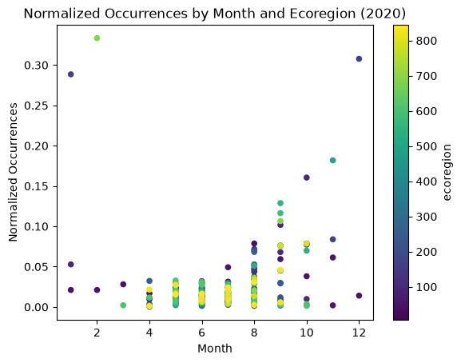

# Arctic Tern Migration

Arctic Tern (Sterna paradisaea) are a species of seabird and are known to have one of the longest migrations in the world, as they travel from the Arctic to the Antarctic every year. Arctic Tern are affected by the impacts of climate change (Morten et al., 2023). These birds are also culturally significant for indigenous communities, as their eggs are important for subsistence harvesting.

## Research question
> Given that the Arctic is experiencing the effects of climate change at a much faster rate than the rest of the world, where do Arctic Tern spend most of the year and when do they migrate? How much of their year is actually spent at the poles versus actively migrating.

## Load required libraries

  

## Create directory for data

## Download and plot ecoregions

## Load GBIF data
**Species Occurrence Data:** The data we're using comes from the Global Biodiversity Information Facility (GBIF) website (https://www.gbif.org/taxon/6ZSDC), which reports geospatial species occurrence data. Specifically, we're using Arctic Tern data from 2020. 
**Ecoregion Data:** 

    <Axes: title={'center': 'Normalized Occurrences by Month and Ecoregion (2020)'}, xlabel='Month', ylabel='Normalized Occurrences'>

    

    

> This scatterplot shows us the normalized occurrences of Arctic Tern by month and ecoregion. We can see that at the start of the year, Arctic Tern are seen in 3 main ecoregions which are located near the poles. As the year goes on and we move towards summer in the northern hemisphere, we see Arctic Tern in a wider range of ecoregions in both polar and temperate regions, with low occurrences across ecoregions. Moving from June to October, we see a decrease in the number of ecoregions and an increase in the normalized occurrences in each of these ecoregions. From October to December, we see a gradual decrease in the number of ecoregions, with most occurrences shifting to polar regions, and the normalized occurrences in the few regions with Arctic Terns gradually increased as the number of ecoregions decreased.

  

                                                   

    WARNING:bokeh.core.validation.check:W-1005 (FIXED_SIZING_MODE): 'fixed' sizing mode requires width and height to be set: figure(id='777d1cde-5f74-4a91-9265-02a4ae044da4', ...)
    

    

    BokehModel(combine_events=True, render_bundle={'docs_json': {'41ffc558-b2b1-47fe-9c59-7ce1c5975822': {'version…

## Interactive Map
> Another way of visualizing the data seen in the previously shown scatterplot is in an interactive map. Here, we show the spatial distribution of Arctic Tern by month. This gives us insight into some of the trends in migration patterns that may exist for this species. 

## Limitations
> Some limitations that are important to note include the fact that the occurrence data used here is limited by observations.

## Bibliography

> Morten, J. M., Buchanan, P. J., Egevang, C., Glissenaar, I. A., Maxwell, S. M., Parr, N., Screen, J. A., Vigfusdottir, F., Vogt-Vincent, N., S., Williams, D. A. (2023) Global warming and arctic terns: Estimating climate change impacts on the world's longest migration. Global Change Biology. https://doi.org/10.1111/gbc.16891
>
>Alerstam, T., Backman, J., Gronroos, J., Olofsson, P., Strandberg, R. (2019) Hypotheses and tracking results about the longest migration: The case of the arctic tern. Ecology and Evolution. https://doi.org/10.1002/ece3.5459

    [NbConvertApp] Converting notebook 06-portfolio-post.ipynb to html
    [NbConvertApp] WARNING | Alternative text is missing on 1 image(s).
    [NbConvertApp] Writing 445945 bytes to 06-portfolio-post.html
    
